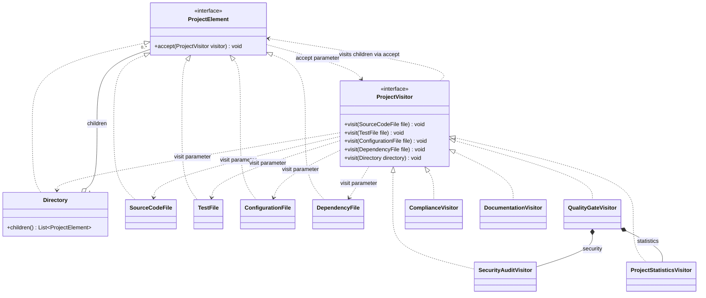
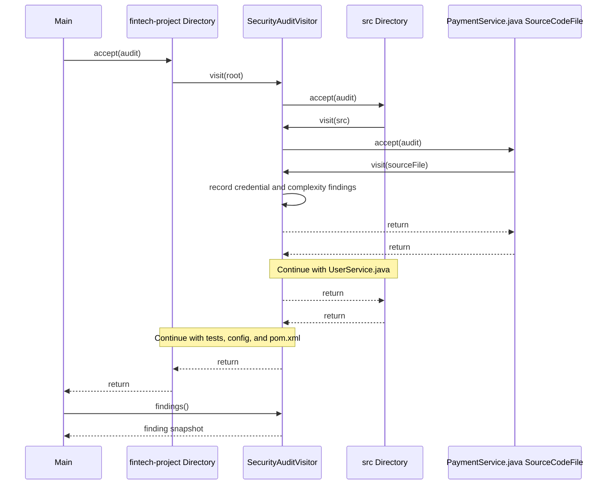

# Smart Code Inspection and Compliance Engine

Assignment 6 · Visitor Pattern · Java 17+

Five visitors inspect the same fintech project model and produce separate reports. The Java files, tests, Maven configuration, and this README all live at the repository root. The demo directory tree is constructed in memory, and its findings come from illustrative metadata.

## Run the demo and tests

Use JDK 17 or newer and Maven 3.6.3 or newer. From the repository root, run:

```sh
mvn clean test
java -cp target/classes Main
```

To run the demo using the JDK alone:

```sh
javac --release 17 -d out Main.java
java -cp out Main
```

[InspectionTest.java](InspectionTest.java) contains 16 JUnit 5 tests covering dispatch, each report, release thresholds, nested and empty directories, and edge cases.

## Demo project

```text
fintech-project/
├── src/
│   ├── PaymentService.java
│   └── UserService.java
├── tests/
│   └── PaymentServiceTest.java
├── config/
│   └── application.properties
└── pom.xml
```

| Visitor | What it reports | Demo result |
| --- | --- | --- |
| Security audit | Credential exposure, plaintext transport, known vulnerable dependencies, and sensitive source files with complexity of at least 15 | 2 critical and 2 high findings |
| Project statistics | File counts, source and test lines of code, test cases, dependency entries, average source complexity, and the ratio of test files to source files | 5 files, 390 lines, 6 test cases, 2 dependencies, 12.00 average complexity, and a 0.50 ratio |
| Quality gate | No critical security issues, average complexity at most 10, and a test-to-source file ratio of at least 0.40 | Security FAIL, complexity FAIL, tests PASS, overall FAILED |
| Compliance | Credentials in source or configuration, missing dependency versions, prohibited dependency coordinates, and production modules without any test cases | 4 violations, including missing tests for the users module |
| Documentation | Fraction of documented source files and their undocumented counterparts by name | 1 of 2 documented. PaymentService.java is missing documentation. |

Directories are excluded from file counts. A project without source files reports zero for average complexity, the test-to-source ratio, and documentation coverage. The quality gate and module coverage measure different things. The demo has enough test files to pass the ratio threshold, but its test cases cover only the payments module. Each visitor accumulates results during a traversal, so create fresh instances for a new project.

## How the pattern works

- **Problem and roles.** The same project tree needs several independent operations. [ProjectElement.java](ProjectElement.java) defines the common element contract. Five records implement it. [ProjectVisitor.java](ProjectVisitor.java) declares the typed operations, and each concrete visitor implements one analysis. Putting audits and metrics directly on the records would force changes across the element classes whenever an operation was added.
- **Double dispatch.** When the caller invokes `accept` on a `ProjectElement`, Java selects the concrete element's implementation at runtime. Inside that method, the concrete type of `this` determines the overloaded `visit` signature at compile time. Java then selects the concrete visitor's implementation at runtime. Both objects' types determine which behavior runs, with no type checks or switches.
- **Adding a visitor.** Implement the existing `visit` overloads in a new class, then pass an instance to `accept`. The Documentation Visitor was added in its own commit. It reused the source documentation flag and the default directory traversal, so the element classes and interfaces needed no edits.
- **When Visitor is a poor fit.** If new element types arrive frequently, every new type can trigger edits across all existing visitors. For one simple operation on a small, changing hierarchy, the extra interfaces and dispatch are often more work than the operation itself.
- **Visitor and Strategy.** Strategy makes implementations of a single task interchangeable. Visitor defines an operation whose behavior varies across the different element types in a hierarchy. Here the client runs all five visitors over one tree because each visitor answers a different question.
- **SOLID.** Single Responsibility separates project data from each analysis. Open/Closed applies along the operations axis because a new visitor can extend the engine without changing the model. Dependency Inversion appears in the dispatch path because the elements depend on the `ProjectVisitor` interface and directory traversal depends on `ProjectElement`. The visitor interface deliberately covers every element type, even when a particular analysis has nothing to do for some types.

### Adding DatabaseMigrationFile

1. Define `DatabaseMigrationFile implements ProjectElement` and implement `accept` with `visitor.visit(this)`.
2. Add `void visit(DatabaseMigrationFile file)` to `ProjectVisitor`. Without this overload, the new element cannot compile.
3. Implement the overload in all five concrete visitors and in test visitors that implement the interface, including the dispatch spy in `InspectionTest`. They can analyze or deliberately skip migrations according to their purpose. For example, statistics could count the file and security could check its metadata. Quality Gate should forward the element to its delegates if the migration contributes to their results.
4. Place a migration in the tree and extend tests and diagrams to show the new behavior. `ProjectElement`, existing element records, and directory traversal already support any element implementing the interface.

## UML class diagram



## UML sequence diagram

This excerpt follows the security visitor through the source branch. The directory visits use the default implementation in `ProjectVisitor`.



## Defense and live modification

For a practice change, require a high-severity finding when a sensitive source file is undocumented. Predict which report changes, explain why the rule belongs in `SecurityAuditVisitor.visit(SourceCodeFile)`, implement it, run the demo, and add a focused assertion. The model already supplies both flags. In the demo, PaymentService.java gains a finding and the critical issue count stays at two.

If `accept` were removed, traversal would lose the polymorphic handoff to each concrete element. With a reference typed as `ProjectElement`, the caller cannot select a concrete `visit` overload simply by passing the reference to the visitor.

## GitHub and Moodle

Create an empty public GitHub repository. From this repository's root, add it as the remote and push the existing branch so the assignment's commit history is preserved:

```sh
git remote add origin https://github.com/YOUR-USERNAME/YOUR-REPOSITORY.git
git push -u origin main
```

Use this README for the Moodle submission and include the public repository link.
